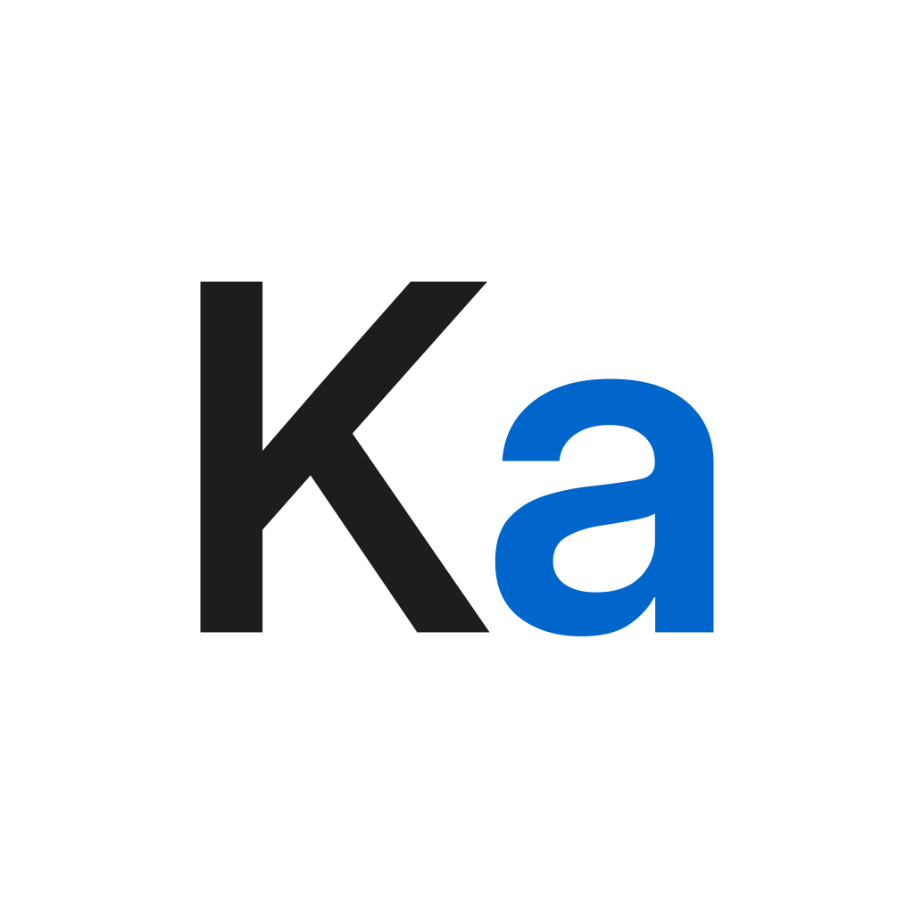

<p align="center">
  
</p>

<h1 align="center">kagami</h1>

<p align="center">
  에이전트는 고른 일 하나만 끝내고, 기록을 남기고, 멈춘다. 흐름은 사람이 쥔다.
</p>

<p align="center">
  <a href="LICENSE"></a>
  <a href="https://github.com/Pancheble/kagami/releases"></a>
  
</p>

<p align="center">
  <a href="README.md">English</a> · <b>한국어</b>
</p>

## 왜 kagami인가

AI한테 "해줘"만 하면 처음엔 빨라요. 그런데 나중에 고치려고 열어 보면, 왜 이렇게 됐는지 나도 AI도 몰라요. 그래서 고치는 데 한세월 걸려요.

혼자일 때는 결정이 대화와 함께 사라져요. 팀일 때는 일을 대충 나눠서 서로 뭘 만드는지 모르고, 맞물리는 곳에서 코드가 부딪혀요. 결국 둘 다 "일을 어떻게 나눴냐"의 문제예요.

kagami는 이렇게 나눠요.

- **일을 트리로 나눠요.** 나누는 안은 AI가 내고 사람이 골라요. 할 차례가 된 것만 나눠요
- **조각끼리의 약속을 먼저 테스트로 세워요.** 나눌 때 실행되는 테스트를 먼저 써 두니까, 각자 만들어도 부딪히면 CI가 알려 줘요
- **누가 무엇을 하는지, 왜 그렇게 정했는지가 이슈에 남아요.** 트리의 그 자리 이슈에 남아서 다음 세션이나 팀원이 이어받아요

"그냥 해줘"보다는 느려요. 대신 나중에 한세월 걸리지 않아요. AI를 더 오래 혼자 돌리는 도구는 아니에요.

**근거:** 같은 프로젝트를 "다 맡기기"와 "kagami 방식"으로 두 번 만들고 있어요. 결과는 나오면 여기에 채울게요(지금은 확인 중).

### 비슷한 도구와 다른 점

비슷한 도구들도 일을 나눠요. 목적이 달라요. 아래 도구들은 AI 에이전트 여럿을 함께 돌리거나 명세를 작업으로 바꾸려고 나누고, kagami는 사람이 흐름을 쥐고 여러 사람이 같이 일하려고 나눠요.

| | 일이 있는 곳 | 언제 나누나 | 조각을 맡는 쪽 | 조각 사이의 약속 |
|---|---|---|---|---|
| [CCPM](https://github.com/automazeio/ccpm) | GitHub 이슈와 `.claude/epics/` 파일 | 기획서 → 에픽 → 작업. 에픽마다 한 번에 | 병렬로 도는 에이전트 | 작업 파일의 `depends_on`·`conflicts_with` 표시, 에이전트마다 맡은 파일 |
| [Spec Kit](https://github.com/github/spec-kit) | 저장소의 `specs/<기능>/tasks.md` | 명세 → 계획 → 작업. 기능마다 한 번에 | 에이전트. `[P]` 작업은 병렬로 | 계획 단계의 `contracts/` 인터페이스 문서와 계약 테스트 작업 |
| [BMad Method](https://github.com/bmad-code-org/BMAD-METHOD) | 저장소의 기획 문서와 에픽의 `tickets.toml` | 에픽을 스토리로 먼저 나누고, 문제가 보이면 남은 스토리를 다시 나눔 | 에이전트가 스토리를 하나씩. 경계가 분명한 에픽은 병렬로 | 아키텍처 문서와 공유 계약, 에픽 경계의 통합 점검 |
| [OpenSpec](https://github.com/Fission-AI/OpenSpec) | 저장소의 `openspec/changes/<변경>/tasks.md` | 변경마다 제안 → 명세 → 설계 → 작업 | 에이전트(`/opsx:apply`) | 확인 못 함 |
| [Claude Code 에이전트 팀](https://code.claude.com/docs/en/agent-teams)(실험 기능) | 로컬 작업 목록 `~/.claude/tasks/` | 리드 에이전트가 그때그때 | 작업을 스스로 잡는 팀원 에이전트 | 작업 사이 의존성, 팀원마다 다른 파일 맡기 |
| [Marcus](https://github.com/painted-porch/marcus) | 공유 칸반 보드 | 만들 것을 설명하면 Marcus가 나눔 | 보드에서 작업을 잡는 여러 에이전트 | 나누기 전에 만드는 영역 사이 인터페이스 계약(타입·API 모양) |
| **kagami** | GitHub 이슈 트리 | 할 차례가 된 노드만. AI가 안 2~3개를 내고 사람이 고름 | 사람과 그 사람의 Claude Code 세션. 한 세션에 잎 하나 | 나눌 때 `contracts/<노드 번호>/`에 쓰는 실행되는 테스트. 한 번 초록이 된 계약이 빨개지면 CI 가드가 막음 |

계약을 먼저 세우고 나누는 방법은 이미 알려져 있어요. kagami는 [Marcus의 contract-first decomposition](https://github.com/painted-porch/marcus/blob/main/docs/source/concepts/contract-first-decomposition.md)과 [James Phoenix의 글](https://understandingdata.com/posts/contracts-parallelize-agents/)에서 이 방법을 빌려 왔어요. 이 방법과 다른 빌려 온 방법(ADR/MADR, 트렁크 기반 개발, parallel change 등)은 [방법론 지도](docs/design.md#methodology-map)에 있어요.

<sub>2026-11-08에 각 도구의 공식 README와 문서로 확인했어요: [CCPM README](https://github.com/automazeio/ccpm#readme), [Spec Kit README](https://github.com/github/spec-kit#readme)와 [템플릿](https://github.com/github/spec-kit/tree/main/templates), [BMad Method README](https://github.com/bmad-code-org/BMAD-METHOD#readme)와 [Choose a Planning Path](https://docs.bmad-method.org/plan/choose-a-planning-path/), [OpenSpec README](https://github.com/Fission-AI/OpenSpec#readme), [Claude Code 에이전트 팀 문서](https://code.claude.com/docs/en/agent-teams), [Marcus README](https://github.com/painted-porch/marcus#readme). 틀린 곳이 있으면 Issues로 알려 주세요.</sub>

> [!NOTE]
> kagami는 지금 **베타**(`v1.0.0-beta.2`)예요. 깨지는 곳이 있을 거예요. 겪은 일을 [Issues](https://github.com/Pancheble/kagami/issues)에 남겨 주세요.

## 빠른 시작

[Claude Code](https://docs.claude.com/en/docs/claude-code), Node 24 이상, 로그인된 [GitHub CLI](https://cli.github.com)(`gh auth login`)가 필요해요.

1. Claude Code에서 마켓플레이스를 더해요:
   ```
   /plugin marketplace add Pancheble/kagami
   ```
2. 플러그인을 설치해요:
   ```
   /plugin install kagami@kagami
   ```
3. GitHub에 빈 저장소를 만들어 클론하고, 그 폴더에서 Claude Code를 열어 실행해요:
   ```
   /kagami:init
   ```

그다음 `/kagami:plan`으로 목표를 정하고, 그 뒤로는 세션마다 `/kagami:next`로 시작해요.

## 어떻게 돌아가나

```
root(목표) › branch(써 볼 수 있는 덩어리) › node › leaf(PR 하나)
```

한 바퀴: `next`가 추천 → 사람이 고르기 → `build`가 테스트 먼저 → 평가자 판정 → `dev`로 PR → 사람이 머지. 가지의 잎이 다 닫히면 `try`가 직접 써 보는 걸 안내해요.

에이전트가 따르는 규칙은 [AGENTS.md](AGENTS.md), 규칙이 왜 이런지는 [docs/design.md](docs/design.md), 사람이 할 일은 [CONTRIBUTING.md](CONTRIBUTING.md)에 있어요(영어).

## 명령

| 명령 | 하는 일 |
|---|---|
| `/kagami:init` | 새 빈 저장소에 kagami 깔기: 규칙, 이슈 템플릿, 라벨, CI 가드 |
| `/kagami:plan` | 만들고 싶은 것을 대화로 목표 이슈로 만들기 |
| `/kagami:next` | 다음에 할 일 2~3개를 추천하고 고른 것을 시작하기 |
| `/kagami:split` | 큰 이슈를 한 세션에 끝나는 조각으로 나누기 |
| `/kagami:build` | 잎 하나를 테스트 먼저 만들고, 평가자 판정을 받고, PR 열기 |
| `/kagami:test` | `build`가 안에서 돌리는 빨강 → 초록 → 정리 반복 |
| `/kagami:try` | 다 만든 가지를 직접 써 보기. 괜찮으면 닫고, 아니면 고칠 일을 만들기 |

## 자주 묻는 것

**이미 있는 프로젝트에도 쓸 수 있나요?**
아직은 아니에요. `/kagami:init`은 새 빈 저장소만 받아요.

**팀으로 쓸 수 있나요?**
네. 모두 같은 이슈 트리에서 일을 고르고, 고른 일은 할당돼서 다른 사람 세션은 추천하지 않아요.

**GitHub가 꼭 있어야 하나요?**
네. 트리가 GitHub 이슈에 있고, PR은 CI 가드를 거쳐요.

**Claude Code 말고 다른 에이전트에서도 되나요?**
규칙은 `AGENTS.md`에 글로 있지만, 명령은 Claude Code 스킬이에요.

## 라이선스

[MIT](LICENSE). 스킬 일부는 [mattpocock/skills](https://github.com/mattpocock/skills)(MIT)에서 가져와 고쳤어요. [THIRD_PARTY_NOTICES](THIRD_PARTY_NOTICES)를 보세요.
